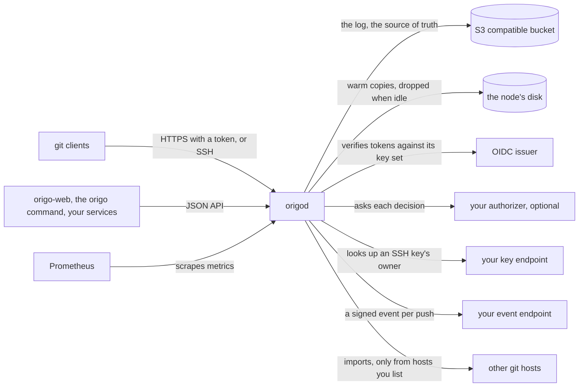

# Origo

**Git hosting as an infrastructure component.** Every push is an entry in a
write-ahead log in S3 compatible object storage. Repositories on disk are
only a cache. There is no database, no leader, and no consensus cluster.

Origo is not a hosted service. Anyone with a Kubernetes cluster and an S3
compatible bucket can run their own.

[](https://github.com/latere-ai/origo/actions/workflows/verify.yml)
[](https://github.com/latere-ai/origo/releases)
[](go.mod)
[](LICENSE)

## Status

Origo follows semantic versioning on its release tag, and
[what the number promises](docs/upgrades/README.md#what-the-number-promises)
says which change bumps which part. The
[releases](https://github.com/latere-ai/origo/releases) carry the signed
images, the `origod` and `origo` binaries, and the manifests.

Everything under [What you get](#what-you-get) is served today. These are
designed and not built yet:

| | |
|---|---|
| Forks | a repository that starts from another's history without copying it |
| Blame | which commit last changed each line of a file, on the read API |
| Compare | the merge base, ahead and behind, and per-file counts as JSON |
| Rebase merges | the merge endpoint replays a branch's commits onto the target |
| Hidden references | namespaces a fetching client is not shown |
| Batched pushes | concurrent pushes to one repository share one log commit |
| Faster large clones | the bulk of a clone served from the bucket, and git's commit-graph and bitmap indexes written once for every node |

Origo has had no external security audit. The
[security policy](SECURITY.md#what-is-protected) names the test behind
each commitment it makes.

## The problem

Some platforms need one git repository per unit of work: a repository per
project, a repository per sandbox session, a repository per agent run. A
conventional git server does not fit that shape. It keeps every repository
on a specific disk, so nodes are not interchangeable, growth means
migration, and a million repositories that nobody fetches still cost a
million repositories' worth of storage and backup.

Origo gives each of them a real git remote over HTTPS and SSH, and pays
for the ones in use.

## Quickstart

You need Go 1.27 or newer, `git`, `curl`, `openssl`, and Docker or
Podman with Compose.

```sh
git clone https://github.com/latere-ai/origo.git && cd origo
mkdir -p out
make dev > out/dev.log 2>&1 &
until grep -q '^git clone http' out/dev.log; do sleep 2; done
$(grep '^git clone http' out/dev.log) out/hello && cd out/hello
git commit --allow-empty -m first && git push origin HEAD:main
git ls-remote origin
```

`make dev` starts MinIO with a bucket, a stub identity provider, a stub
authorization endpoint and an event sink, then runs the node. Once it is
ready it creates the repository `dev/hello` and prints a clone line with
a token in it, which the fifth line runs to clone into `out/hello`. The
commit is pushed to the node, written to the log in the bucket, and
listed back:

```
<commit id>	HEAD
<commit id>	refs/heads/main
```

`kill %1` stops the node, and `make dev-down` from the root of the
clone stops MinIO. `make clean` also deletes the repositories and `out/`.
[Running it locally](docs/local.md) is the same, step by step, with the
read API and the `origo` command.

## How it fits



- **Git clients** clone, fetch and push over HTTPS with a bearer token or
  over SSH with a key; **API clients** read and write through JSON.
- **The bucket** is the only state that matters: every push is an entry
  in its log. **A node's disk** holds warm copies it can always rebuild.
- **Your issuer** signs the tokens, and Origo stores no users.
  **Your authorizer** decides who may read, write or administer a
  repository; without one, the built-in owner policy decides.
  [Authorization endpoint](docs/authorizer.md) is its contract, with the
  SSH key endpoint's.
- **Your event endpoint** receives a signed delivery for each reference
  update, so a build or a review starts from a push.
- **Other git hosts** are reached only to import a repository, and only
  the ones you list.
- **Prometheus** scrapes the metrics, and an OTLP collector, when you set
  one, receives the traces and logs.

## How it works

Object storage is the source of truth, not a backup of it.

- **A push is a log entry.** Origo writes the packfile and the reference
  update to the log in your bucket, then acknowledges. Nothing is
  acknowledged before it is durable.
- **`If-None-Match: *` is the whole lock.** A create-if-absent write on the
  next log slot linearizes concurrent pushes. That is the only coordination
  primitive Origo needs, so there is no Raft group and no leader election to
  operate.
- **Nodes are stateless and hold no routing table.** Any node serves any
  repository. A repository missing from a node's disk is rebuilt from the
  log on the next request and dropped again when it goes idle. Adding,
  replacing, or losing a node needs no migration.
- **Idle repositories cost storage and nothing else.** A busy monorepo gets
  as many warm copies as its reads need; a million quiet ones keep no local
  copy at all.

## Install it for real

[`docs/install.md`](docs/install.md) goes from a Kubernetes cluster and a
bucket to a first push, in about an hour. Every command on that page is run
against a throwaway cluster by the project's own tests before it is
published, so a command that drifts from the manifests fails the build
rather than your installation.

You supply a bucket at any S3 compatible endpoint that honors conditional
creates, an OIDC issuer, and a hostname. Origo verifies every request
against your issuer and stores no users. Permission comes from one HTTP
endpoint you write, which answers whether a subject may read, write, or
administer a repository; for one person or one team, the built-in owner
policy needs no endpoint at all.

## What you get

- **A git remote.** `git clone`, `fetch`, and `push` over HTTPS with a
  bearer token, or over SSH with a public key your key store resolves.
  Shallow and partial clones work at any reachable commit. Git LFS is
  supported.
- **Consistent reads.** A push commits as one conditional create of the
  repository's next log entry, and a node confirms its copy is current
  before every read, so a read never sees a half-applied push.
- **A read API.** Refs, log, diff, tree, blob, and an archive of any commit
  over JSON, so a product can show history and diffs without cloning.
- **Server-side git.** Create a commit or merge a branch through the API,
  with no working copy anywhere.
- **Push events.** A signed webhook per reference update, so a build, a
  deploy, or a review starts from a push.
- **Acting for a person.** A service that commits for a user presents the
  token its issuer minted for that user, so every push is recorded under the
  user's identity. A token that names two parties at once is refused.
- **A command for an agent.** `origo` reads and changes a repository from a
  shell without cloning it, printing lines a pipeline can filter, so
  `origo ls -r -n 0 | grep -i handler` finds a file in a large repository for
  the cost of one command. It ships in the same release archives.
- **A browsing interface, if you want one.** Origo itself serves git and
  JSON and has no web pages. [origo-web](https://github.com/latere-ai/origo-web)
  is a separate, optional program that reads this API and renders
  repositories, history, diffs and files in a browser. Run it or don't;
  Origo neither needs it nor knows about it.

## Day to day

With [origo-web](https://github.com/latere-ai/origo-web) in front of it, a
person signs in, creates a repository, registers a public key, and clones:

```sh
git clone git@git.example.com:owner/name.git
```

Commit and push as anywhere else. Over HTTPS a public repository clones
with no credential when the installation admits anonymous reads
(`ORIGO_ANONYMOUS_READ`), and a private one takes a bearer token as the
password, with any username. `owner/name` is the name a person sees; the
API and its tokens use the repository's identifier, which a rename does
not change.

## Documentation

| | |
|---|---|
| [Running it locally](docs/local.md) | the node and everything it needs on one machine, from a clone, with a push and requests that show it working |
| [Install](docs/install.md) | from a cluster and a bucket to a first push |
| [Configuration](docs/configuration.md) | every environment variable with its default |
| [API](docs/api.md) | authentication, every route with the permission it needs, errors, limits, and push events |
| [Authorization endpoint](docs/authorizer.md) | the endpoint that decides what Origo allows, for whoever writes it |
| [Security](docs/security.md) | what Origo guarantees, what it sees and keeps, what it does not defend, and what an operator keeps safe |
| [Operations](docs/operations.md) | backup, restore, scaling, metrics and alerts, and what to do during an outage |
| [Upgrades](docs/upgrades/README.md) | what a version number promises, and how to verify what you install |
| [Migration](docs/migration.md) | moving repositories in from another git host |
| [The origo command](docs/cli.md) | reading and changing a repository from a shell or an agent, without cloning it |

[`docs/README.md`](docs/README.md) is the index. For contributors,
[`docs/internals/`](docs/internals/README.md) explains how the code is
laid out and tested, and [`specs/`](specs/README.md) holds the design
records with the reasoning behind each decision.

## Contributing

Issues and pull requests are welcome. [`CONTRIBUTING.md`](CONTRIBUTING.md)
covers the quality gate, how to run it locally, and how a change is
reviewed. [`SECURITY.md`](SECURITY.md) is how to report a vulnerability;
please do not open an issue for one.

## Acknowledgments

The storage design follows the approach described by Cursor's engineering
team in [Git at any scale](https://cursor.com/blog/git-at-any-scale): a
write-ahead log in object storage as the source of truth, repositories as a
warm cache, and linearized pushes without a consensus cluster.

Origo is built by Latere.

## License

MIT. See [`LICENSE`](LICENSE).
