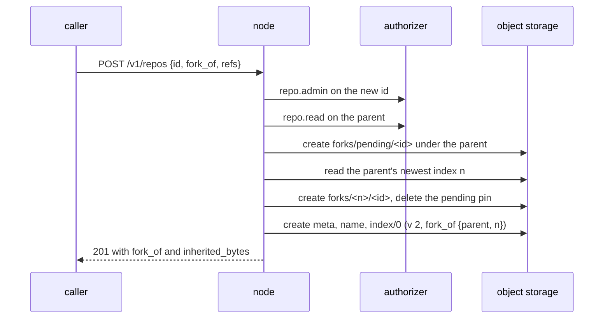

# Forks

## Overview

Spec 001 names "a sandbox service with a repository per session" as an
intended operator. Today a repository per session costs the whole
history of the repository it starts from: a new repository holds
nothing, so its first push carries every object reachable from the
session's base, and the bucket stores that history once per session.
A consumer that cannot pay that keeps per-session state in one shared
repository instead, and the shared repository pays in references.

That is what an agent runtime does now. A hosted session keeps its
checkpoint, the commit of its working files at the end of each turn, at
the repository it works in, under one reference per session that is
pushed every turn and never deleted. Every index object carries the
whole reference map (spec 004), so every push to that repository writes
a new copy of every session's reference, every node that holds the
repository downloads it, and index objects are never deleted (spec 006,
Truncation). At about 112 bytes a reference, 1 000 sessions of 50 turns
each, run one after another, leave about 2.6 GiB of index objects behind;
10 000 leave about 260 GiB. At `limits.MaxRefs` the repository refuses
pushes. One repository also serializes every push of every concurrent
session (spec 005's ceiling of about ten a second).

A fork removes the trade. A fork is a new repository whose first index
object names a parent repository and the parent's index object it
starts from. It copies no object: its nodes read the parent's packs and
entries from the parent's prefix, and the bucket stores only what the
fork itself receives. Creating one writes a handful of small objects
and no pack. For the
runtime above, each session gets a fork of the repository it works in,
keeps its checkpoint there, and is deleted with the session; a forked
session's repository is a fork of its parent session's, so the commit at
the fork point is already among its own objects. The shared repository
keeps only the references people make.

This spec defines the fork: how a fork is created and authorized, how
the index object records its parent, how a node materializes it, why no
object a fork reads is deleted while the fork lives, how compaction
keeps a fork cheap, what a fork exposes to its readers, and what it
costs.

## Current state

Not built. Nothing in the tree shares an object between repositories:
`ParseIndex` accepts a pack only as `packs/<hex>.pack` under the
repository's own prefix (`internal/wal/format.go`), materialization
fetches every key under `RepoPrefix(id)` (`internal/repo/cache.go`),
and spec 016 states "no shared object store, no alternates". Three
paths delete log objects, and each decides from the owning repository's
own newest index alone:

| Path | Runs | Deletes |
|---|---|---|
| `wal.Log.Sweep` (spec 004, Sweeper) | every node, every `ORIGO_SWEEP_INTERVAL`, every repository | entries at or below `compacted_through`, orphan entries, and packs under `packs/` the newest index does not list, once older than `ORIGO_SWEEP_MIN_AGE` by upload time |
| purge (spec 019) | the same sweep, once `deleted_at` is older than the hold | every object under the prefix but `meta` |
| the weekly orphan sweep (spec 019) | one node, Sundays | an object under a known prefix that no index names, and every object under an unknown prefix, after 7 days |

The minimum age counts from the object's upload, not from when an index
stopped listing it, so a pack uploaded a week ago is deleted at the
first sweep after a compaction supersedes it.

## Decision record

| Option | Shape | Why not |
|---|---|---|
| Copy on fork | a fork's first compaction entry lists copies of the parent's packs under the fork's prefix | the bucket stores the history once per fork, which is today's cost with a faster first push |
| One shared pack store with a mark-and-sweep collector | packs under a global prefix, deleted when no index object of any repository lists them | the collector reads every repository's newest index before it can delete anything, deletion waits for the weekly sweep, and every repository's packs move out of its prefix |
| Pins under the parent, the fork naming the parent's index object | this spec | chosen: a create copies nothing, each repository's objects stay under its prefix, every deleter decides from objects under the one prefix it already reads, and a repository that is never forked changes not at all |

## Design

### Creating a fork

`POST /v1/repos` takes one more field, `fork_of`, the id of the parent,
and one optional field, `refs`:

```json
{"id": "<new id>", "owner": "acme", "slug": "session-7f3a",
 "fork_of": "<parent id>", "refs": ["refs/heads/feature"]}
```

| Field | Rule |
|---|---|
| `fork_of` | an existing repository that is not deleted; absent means a repository with no parent, as today |
| `refs` | the references the fork starts with, each present in the parent's index, at most `limits.MaxRefs`; absent means the parent's default branch alone. `HEAD` is the parent's unless `default_branch` is given, and may name a branch the fork did not copy, which git reads as an unborn branch |
| `default_branch` | as today; with `fork_of`, it sets the fork's `HEAD` |

The default is the default branch alone because the fork's reference
map is rewritten on every push the fork takes: copying every branch of a
parent with thousands of agent branches would hand each fork the
problem this spec removes. A caller that bases work on another branch
lists it, which also keeps git's push negotiation small.

The node that takes the request:

1. Asks the authorizer twice, with today's actions: `repo.admin` on the
   new repository, the question every create asks (spec 028), and
   `repo.read` on the parent. A deny of either is the create's deny. No
   action is added, so the authorizer contract does not change.
2. Creates the pending pin `origo/repos/<parent>/forks/pending/<new id>`
   by create-if-absent (Pins, below).
3. Reads the parent's newest index object, `n`, through the currency
   check. A parent marked deleted is 404 `repo_not_found`, and the pin
   is deleted.
4. Creates the pin `origo/repos/<parent>/forks/<n>/<new id>`, `<n>` in
   the twelve digits of an index key, then deletes the pending one.
5. Creates the repository as `POST /v1/repos` does today, writing spec
   004's four objects (`meta`, the name, `index/000000000000`, the
   hint), with index 0 carrying the parent reference and the chosen
   references:

   ```json
   {"v": 2, "seq": 0, "entry": "",
    "refs": {"HEAD": "ref: refs/heads/main", "refs/heads/feature": "<sha>"},
    "entries": [], "packs": [], "compacted_through": 0,
    "size_bytes": 0, "deleted_at": null, "pushed_at": null,
    "fork_of": {"repo": "<parent id>", "seq": 1043},
    "inherited_bytes": 734003200}
   ```

A failure after step 2 deletes the pin before the node answers, and the
sweeper's rule for an abandoned pin covers a node that died first. The
whole operation runs under the 5 minute deadline of spec 004, far
inside `ORIGO_SWEEP_MIN_AGE`, which is what the abandoned-pin rule
relies on. Creating a fork reads one index object, writes two pins and
deletes one, and writes the create's four objects; it copies no pack,
whatever the parent's size.



### The index object

Two fields join the index object of spec 004:

| Field | Meaning |
|---|---|
| `fork_of` | `{"repo", "seq"}`: the parent and the parent's index object the fork starts from. Set on index 0 and copied forward unchanged by every later commit; absent on a repository with no parent |
| `inherited_bytes` | the parent's `size_bytes` plus the parent's own `inherited_bytes` at that index object, fixed at the fork's creation and copied forward |

An index object that carries `fork_of` is written with `v: 2`; every
other index object is still written with `v: 1`, and entry headers stay
at 1. A release that reads only version 1 therefore refuses forks alone,
through the path spec 017 already defines (`NewerFormatError`, 503
`repository_unavailable`), and serves every other repository, so a
rollback past this spec costs the forks and nothing else. An
installation that never forks writes nothing a previous release cannot
read. Spec 017's sentence that a node writes the newest version becomes:
a node writes the lowest version that can hold the object. The change
adds a capability and rewrites no object, so it is a minor release by
spec 017's table, and no migration ships with it. The refusal of an
older release names `docs/upgrades/2.md`, so that document ships with
the build and says what it is: forks need this release or a later one,
there are no steps, and nothing is rewritten.

The fork names its parent's index object rather than listing the
parent's packs and entries. Index objects are immutable and never
deleted while their repository lives (spec 006), so the reference is
stable, and the fork's own index objects grow by one fixed-size field
however deep the chain of forks is. A list would be copied into every
index object of the fork, which is the cost this spec exists to
remove.

A fork of a fork names its own parent only. The chain is followed at
materialization, at most `limits.MaxForkDepth` (16) parents deep; a
create whose parent is already at that depth is 400 `invalid_request`
with `details.field` `fork_of`. The bound keeps a cold materialization's
extra reads, one index object per ancestor, small.

### Materializing a fork

`Apply` (spec 004, Materialization) reads the chain first: the fork's
`fork_of` names the parent's index object `m`, whose own `fork_of` names
the grandparent's, up to a repository with no parent. Each of those
index objects is immutable, so a node keeps them on disk beside the
copy and reads each once. Then, root first:

1. For each ancestor, its listed packs are fetched from the ancestor's
   prefix and its listed entries are applied from the ancestor's prefix,
   each verified as step 3 of spec 004 verifies an entry. An ancestor's
   entries are indexed in `index-pack` runs of their own, never joined
   with a later repository's, so each resulting pack holds one
   ancestor's objects.
2. Every pack written in step 1 gets a `.keep` file beside it.
3. The fork's own packs and entries are applied as today. A thin pack
   the fork received resolves its bases among the ancestors' objects,
   which are already on disk.
4. References are reconciled to the fork's own reference map alone; an
   ancestor's references are never applied.

A missing ancestor object is an integrity error, answered
`repository_unavailable`, the answer spec 015 gives a missing object of
the repository's own.

### Compaction of a fork

A fork's compaction folds only what the fork received. `git repack`
never rolls a pack with a `.keep` file into a new one, so the geometric
roll-up of spec 006 leaves every ancestor pack alone, and the run's pack
set is the multi-pack index's packs less the kept ones. Step 6's swap,
which deletes the packs on disk the new index does not list, deletes no
kept pack. Without this,
the fork's first compaction would repack its ancestors' history into
new packs under the fork's prefix and the fork would cost a full copy;
a session of 50 turns is close to the 64-entry threshold, so that
would be the common case. `Packs` therefore lists only the fork's own
packs, and a compaction's `size_bytes` is their bytes. The carry by
relative key of step 4 is unchanged, because a fork's own packs are
under its own prefix.

### Pins: no object a fork reads is deleted while it lives

A pin is an empty object under the parent's prefix, and its key says
everything a deleter needs, so one listing reads every pin with no
body to fetch:

| Key | Meaning |
|---|---|
| `forks/pending/<child>` | a fork of this repository is being created and has not yet read an index object |
| `forks/<seq>/<child>` | the fork `<child>` starts from this repository's index object `<seq>`; the entries and packs that index object lists stay |

A parent has one pin per direct child. A grandparent's objects are
protected by the parent's own pin under the grandparent, and a purge of
the parent keeps that pin while the parent holds pins of its own
(below). Many forks of one parent name few distinct sequences, and the
index objects they name are immutable, so a deleter reads each once.

| Deleter | Change |
|---|---|
| `wal.Log.Sweep` | when it has an entry or a pack to delete, and only then, lists `forks/` after it reads the newest index object and before it deletes. An entry or a pack listed by an index object a pin names is kept. While a pending pin younger than `ORIGO_SWEEP_MIN_AGE` exists, the sweep deletes no entry and no pack of that repository this round. A pending pin older than that is abandoned and deleted; when the child's index 0 exists, the sweep first creates the pin its `fork_of` names |
| purge | deletes every object under the prefix except `meta`, the pins under `forks/`, the index objects the pins name, the entries and packs those index objects list, the `lfs/` objects, and the purged repository's own pin under its parent when it has one. When the last pin under it is gone, the next sweep deletes the rest, its pin under its parent included |
| the weekly orphan sweep | knows `forks/` under every repository, and knows a key the pins protect. A pin whose child's `meta` carries `purged_at`, or whose child has no `meta` and is older than `ORIGO_SWEEP_MIN_AGE`, is an orphan |

A repository whose `meta` carries `purged_at` is gone whatever index
objects its pins keep: the API answers `gone` from the tombstone before
it reads an index, and the sweep of a purged repository deletes only
what no pin protects. The purge of a fork deletes its pin under its
parent after its own objects, so the parent's sweep reclaims what that
fork alone protected.

The pending pin closes the race between a fork reading its parent and
the parent's sweep. The sweep reads the parent's newest index object
and then lists the pins. If a fork read an index object that still
listed a pack the sweep is about to delete, the fork read it before the
index object that superseded the pack existed, and the sweep read that
later index object after it existed, so the fork's pending pin, created
before its read, is in the sweep's listing, pending or complete. A fork
that read the newer index object never names the superseded pack. The
price is that a parent forked without pause can skip its deletions for
a round; reclaiming waits for a round with no fork in flight, and
nothing is deleted early.

### What a fork exposes

`uploadpack.allowAnySHA1InWant` is on in every copy (spec 004), and the
read API serves objects by id. So a fork's readers can read every object
its ancestors held at the fork point: the history of references the fork
did not copy, a session's checkpoint in the parent, and a secret a later
force push removed from the parent. Removing an object from a parent
does not remove it from the parent's forks.

The rule a consumer follows: a fork's readers are people and services
who may read its parent. Spec 016's row on cross-repository leakage
changes from "no shared object store" to: one bare repository per id
on a node, and a fork's copy holding its ancestors' objects at the fork
point by design. On a node nothing else changes: a fork's copy is its
own directory with its own objects, and no alternates file points from
one repository's copy into another's.

Serving only objects reachable from the fork's own references
(`uploadpack.allowReachableSHA1InWant`) was weighed and refused: every
route of spec 009 that takes an object id would need the same
reachability walk, and the consumer's read rule already makes a fork's
readers the parent's readers.

### LFS

A fork serves its ancestors' LFS objects. The batch API's download of
an object the fork does not hold looks for `lfs/verified/<oid>` in each
ancestor, nearest first, and presigns the first it finds, so a pointer
the fork inherited downloads as it did from the parent. An upload is
checked against the fork's own objects alone, as today; an object an
ancestor already holds is stored again, which spec 010 already accepts
for any two repositories. A purge that keeps pinned objects keeps
`lfs/` whole, because a pin does not say which LFS objects a fork's
pointers name.

### Size, quota, and the representation

`size_bytes` stays what the log holds for the repository itself, so the
quota of spec 012 counts only what a fork received. A fork's
representation adds `fork_of` (the parent's id and sequence) and
`inherited_bytes`. Packs and entries kept only because a fork pins
them count toward no repository's `size_bytes`; `origo_storage_bytes`
of the weekly sweep counts them, so an operator sees the total.

### Other operations on a fork

| Operation | On a fork |
|---|---|
| import (spec 019) | refused with 409 `repo_not_empty`: a fork starts from its parent's history, and an import writes a history of its own |
| delete, undelete, rename, transfer, freeze, export, verify | as on any repository |
| fork | a fork of a fork, up to `limits.MaxForkDepth` |
| push, server-side operations (spec 020), events | as on any repository; the fork's own log, its own push ceiling, its own events |

A parent may be deleted, renamed, transferred, or frozen while it has
forks; none of these changes a fork. A deleted parent is purged after
the hold as above, keeping what its forks read.

### Cost

| Cost | Size |
|---|---|
| create | one index read, two pin writes and one delete, the create's four objects; no pack copied |
| a fork's storage | its own entries and packs, its index objects, one pin |
| a parent's storage while forked | each compaction of the parent supersedes packs that a live fork may still read; those stay until the last fork that reads them is purged. A parent with many long-lived forks holds roughly one copy of its history per compaction generation still pinned. Forks that live as long as a session bound this; a durable fork does not |
| a cold materialization | one index object per ancestor, then the same bytes a clone of the parent at the fork point downloads, then the fork's own |
| node disk | each fork's copy holds its ancestors' objects again; eviction (spec 005) bounds it as for any copy |

## Not in this spec

Hiding a reference namespace such as `refs/topos/` from the reference
advertisement, a separate and smaller change. Merging a fork's work
into its parent on the server: objects flow the other way, so the
parent would read the fork's packs. Detaching a fork into a full copy
of its own. Placing a fork on its parent's primary, and hard-linking a
parent's packs on a node that holds both. The consumer's side: which
repository a session forks, when it deletes the fork, and how a
session's runtime learns the fork's id. Splitting the reference map
into objects of its own, the other way to make a large reference map
cheap, which changes the index format for every repository.

## Acceptance criteria

| Criterion | Test that proves it | State |
|---|---|---|
| `POST /v1/repos` with `fork_of` creates a repository whose index 0 is `v: 2` with `fork_of` and `inherited_bytes`, copies the parent's default branch alone when `refs` is absent and exactly the listed references otherwise, and writes no pack | `internal/api`, `TestForkCopiesNoPack` | not built |
| A fork asks `repo.admin` on the new id and `repo.read` on the parent, and a deny of either refuses it with no object written but the pin, which is deleted | `internal/api`, `TestForkAsksBothQuestions` | not built |
| A fork of a missing or deleted parent is 404 `repo_not_found`, a reference the parent lacks is 400 `invalid_request` on `refs`, a fork past `limits.MaxForkDepth` is 400 on `fork_of`, and an import into a fork is 409 `repo_not_empty` | `internal/api`, `TestForkRefusals` | not built |
| A fresh node clones a fork three levels deep, served from the ancestors' prefixes, and a push to the fork whose thin pack has its bases in an ancestor is accepted | `internal/repo`, `TestForkMaterializesFromItsAncestors` | not built |
| A compaction of a fork uploads no pack of an ancestor, lists only the fork's own packs, and sets `size_bytes` to their bytes, against the real git | `internal/compact`, `TestForkCompactionKeepsAncestorPacks` | not built |
| After the parent compacts and the sweep runs, a fork still materializes cold: every pack and entry its pin protects is kept | `internal/wal`, `TestSweepKeepsWhatAPinProtects` | not built |
| A pending pin stops the parent's sweep from deleting any entry or pack; a pending pin past `ORIGO_SWEEP_MIN_AGE` is deleted, after the sweep creates the pin the child's index 0 names when that index exists; a sweep with nothing to delete lists no pin | `internal/wal`, `TestPendingPinHoldsTheSweep` | not built |
| The race: a fork that reads the parent's index object before a compaction, with the sweep run between that read and the pin's completion, materializes cold afterwards | `internal/wal`, `TestForkRacingACompactionAndASweep` | not built |
| A purged parent keeps what its forks read and its own pin; when the last fork is purged, the next sweep deletes the rest, and the weekly sweep counts none of the kept objects as orphans while they are pinned | `internal/wal`, `TestPurgeKeepsWhatForksRead`; `internal/api`, `TestOrphanSweepKnowsPins` | not built |
| A release that reads version 1 alone refuses a fork with `repository_unavailable` and serves every other repository | `internal/repo`, `TestNewerLogFormatIsRefused` extended with a fork | not built |
| A fork downloads an LFS object only its parent holds | `internal/lfs`, `TestForkDownloadsAnInheritedObject` | not built |
| Against the stack: create a repository, push a history, fork it, fork the fork, push to each, compact the parent, wait a sweep, delete and purge the middle fork with a hold of 0, and clone the last fork from a cold node | `test/e2e`, `TestClusterForkChain` | not built |
| The suite: `032/fork` creates a fork, reads `fork_of` and `inherited_bytes`, clones it, pushes to it, and finds the parent unchanged | `test/conformance`, `TestContract/032/fork` | not built |

## Changes to other specs

Each lands with the build, in the same change:

| Spec | Change |
|---|---|
| 001 | the key table gains `origo/repos/<id>/forks/pending/<child>` and `origo/repos/<id>/forks/<seq>/<child>`; the storage model says a fork reads its ancestors' packs and entries |
| 003 | `POST /v1/repos` takes `fork_of` and `refs`; the representation carries `fork_of` and `inherited_bytes` |
| 004 | the index object's two fields and version 2; materialization's chain; the Sweeper table's pin rows |
| 006 | a fork's compaction leaves kept packs alone; Truncation keeps what a pin protects |
| 012 | `limits.MaxForkDepth` |
| 016 | the cross-repository row and the exposure rule above |
| 017 | a node writes the lowest version that can hold the object; `docs/upgrades/2.md` exists and needs no steps |
| 019 | purge keeps what pins protect; the weekly sweep knows `forks/`; import refuses a fork |
