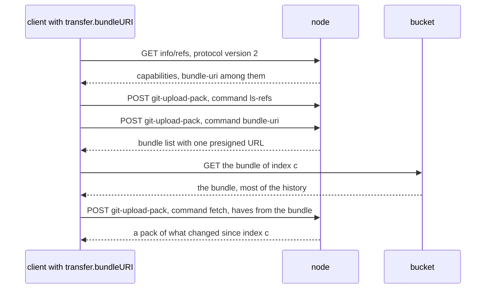

# Bundle URIs

## Overview

A clone of a repository of S bytes costs the node that serves it the
counting and `pack-objects` work over the whole history, S bytes of
egress, and one slot of `ORIGO_MAX_GIT_PROCS` for as long as the client
takes to receive them, under the 5 minute deadline spec 012 gives
`upload-pack`. A client that receives 5 MB a second cannot clone more than
1.5 GB through a node at all: the deadline kills the subprocess first. The
bytes are the same for every clone of the same history, and the bucket
already serves LFS objects to clients directly (spec 010).

Git's bundle URIs let a server name a bundle file at another address
during a protocol v2 clone: the client downloads it, then fetches only what
changed since. Measured with git 2.54.0 on a fixture of 20 300 commits
whose bundle holds the first 20 000:

| Clone | From the node | From the bucket |
|---|---|---|
| plain | 60 975 413 bytes | 0 |
| with the bundle on offer and `transfer.bundleURI=true` | 338 088 bytes of pack, plus 244 bytes of protocol | 60 632 889 bytes, one `GET` |

On the node the catch-up fetch costs 23 ms of `pack-objects` against
130 ms for the full clone with a bitmap and 688 ms without one.

This spec makes compaction write a bundle of the branches and tags of a
large repository to the bucket, makes the node offer it through the
`bundle-uri` command under a presigned URL valid for a few minutes, and
stops offering it as soon as the repository's references no longer reach
everything in it, which is what a force push to remove a leaked secret
leaves behind.

## Current state

Not built. `internal/httpgit` serves protocol v2 when the client sends
`Git-Protocol: version=2`: `Handler.gitCommand` passes it as
`GIT_PROTOCOL`, `Handler.infoRefs` runs `upload-pack --stateless-rpc
--advertise-refs`, and `Handler.uploadPack` streams the request body into
`upload-pack --stateless-rpc` without reading it. Each runs under the
handler's 5 minute `timeout`. Neither sets any `bundle.*` or
`uploadpack.advertiseBundleURIs` key, so no advertisement carries
`bundle-uri`. Over SSH, `internal/sshd` answers the `env` request with
`false` (`requestsAnsweredNo`), so `GIT_PROTOCOL` never reaches a
subprocess and every SSH session speaks protocol v0 (spec 024's decision
9 and spec 016's environment rule).

The node signs bucket URLs for LFS alone: `lfs.NewPresigner` builds a
`pkg/s3` client against `ORIGO_S3_PUBLIC_ENDPOINT`, which defaults to
`ORIGO_S3_ENDPOINT` (`cmd/origod/node.go`), and the batch handler calls
`PresignGet(key, lfs.PresignTTL)`. The one bundle Origo makes is spec
019's export (`internal/api/export.go`), `git bundle create - --all`
streamed through the node. Compaction (`internal/compact/run.go`) writes
packs only.

## Decision record

| Option | Shape | Why not |
|---|---|---|
| Point the client at the compacted packs | protocol v2 `packfile-uris` | git 2.54 configures them as `uploadpack.blobPackfileUri` entries of the form `<object-hash> <pack-hash> <uri>`, one per blob, and leaves every commit and tree to the node |
| A header object joined to a compacted pack | the bundle header in one object, the pack the bucket already holds in another | a presigned `GET` names one object; joining them in the bucket by multipart copy needs every part but the last to be at least 5 MiB, which a header is not; and the compacted packs hold every object the repository ever received, a force-pushed secret included, where a clone receives what its references reach |
| Stream a bundle through the node | spec 019's export, offered to clones | the node still sends S bytes and holds the slot, which is the cost this spec removes |
| A new bundle at every compaction | rewrite on each run | a repository that compacts every 64 pushes would upload S bytes each time; the growth rule below writes one per quarter of growth |
| Withdraw by a marker the push writes | the pushing node writes an object when a push deletes or forces a bundled reference | spec 008 computes `forced` after the commit, so a node that stops between the commit and the marker leaves the bundle offered; moving the check before the commit puts an ancestry walk in every push. The offer check reads only immutable index objects and the copy |
| The list as `-c` arguments | `git -c bundle.<id>.uri=<url> upload-pack` | works, but `repo.Error` prints a failed command's arguments into the log, and the URL is a credential while it lives; the environment keeps it out, as spec 016 already does for the import's egress credential |
| A bundle object written by compaction, offered by a presigned URL | this spec | chosen: the bucket serves the bytes, the bundle holds exactly what a clone of branches and tags receives, and the node decides per request whether it still may |

## Design

### What git does, checked

Every row was checked with git 2.54.0 against `git http-backend` and a
static file server on loopback; the image ships 2.47 (spec 017), which
the build's end-to-end test runs against.

| Behavior | Observed |
|---|---|
| a client without `transfer.bundleURI` (its default is `false`) | sends no `command=bundle-uri`; the clone is the plain one |
| a client with `transfer.bundleURI=true` against an advertisement with `bundle-uri` | sends `command=bundle-uri`, reads `bundle.version=1`, `bundle.mode=all`, `bundle.<id>.uri=<url>`, downloads the URL, then fetches only what the bundle lacks |
| the list given to `upload-pack` as `GIT_CONFIG_COUNT` entries, or as `-c` arguments | both answered exactly as repository configuration would be, an id of the form `b000000001043` included |
| an `https` URL, and a `file` URL | both downloaded |
| a URL answering 403 or 404 | `warning: failed to download bundle from URI '<url>'`, then a full fetch; the clone completes |
| a URL whose host does not answer | the same warning after 77 seconds, the operating system's connect timeout on the client measured, then a full fetch |
| what the clone keeps | `refs/bundles/heads/<branch>` for each branch the bundle holds, beside the remote's references |
| a bundle holding a branch the server deleted | the clone keeps `refs/bundles/heads/<branch>` and every object it reaches; a plain clone holds none of them |
| `--filter=blob:none` or `--depth 1` with `transfer.bundleURI=true` | the whole bundle is downloaded anyway, every blob and every commit |
| `git fetch` with `transfer.bundleURI=true` | sends no `command=bundle-uri`; bundles serve clones only |
| SSH, server dropping the `env` request | protocol v0, no `bundle-uri`; with `GIT_PROTOCOL` passed, the bundle is used |

The last row settles SSH: Origo's SSH sessions speak protocol v0, and
`bundle-uri` is a protocol v2 command, so this spec serves HTTP alone.

### When a repository offers a bundle

All of these hold, decided after the lease on every request:

| Condition | Why |
|---|---|
| the installation sets ORIGO_BUNDLE_URIS to `1` | a client that cannot reach the bucket waits out its connect timeout, 77 seconds on the client measured, on every clone; the operator who knows whether `ORIGO_S3_PUBLIC_ENDPOINT` is reachable from where git runs is the one who turns it on, the way spec 018 already asks it of LFS clients |
| the request is protocol v2 over HTTP | the only place git asks |
| the held index's `size_bytes` is at least `limits.MinBundleBytes` | the deadline bites at 1.5 GB for a 5 MB a second client, but the slot and the egress cost before that: below the threshold a clone through the node holds a slot for under a minute at 10 MB a second, and the bundle's storage and rewrites buy little; the tree has no per-repository clone count, `origo_fetches_total` being per node, so size is the one gate |
| a bundle exists for a compaction at or below the held sequence | Writing the bundle, below |
| the copy is not served stale | a copy served without a currency check (spec 015, `Origo-Stale`) may not have seen the push that withdraws the bundle |
| the offer check passes | The offer check, below |

### Writing the bundle

Spec 006's procedure gains one step on the primary, when the repository's
`size_bytes` after the run would be at least `limits.MinBundleBytes` and
the installation sets ORIGO_BUNDLE_URIS to `1`:

1. After step 3, still under the read lock and through `compact.Slots`,
   decide whether a bundle is due. The primary lists `bundles/` under the
   prefix once and reads the index object the newest bundle names. A
   bundle is due when there is none, when the newest one fails the offer
   check against the held index, or when the held `size_bytes` exceeds
   that index's `size_bytes` by more than `limits.BundleRefreshPercent`
   percent.
2. When due, run `git bundle create <spool>/<id>.bundle --branches --tags`
   in the copy. The bundle holds the branches and tags of the held index
   `n` and every object they reach, and nothing else: no reference under
   another namespace, such as an agent runtime's `refs/topos/`, which a
   clone does not fetch and which would leave one `refs/bundles/` entry
   per session in every clone. The spool lives under `ORIGO_DATA_DIR`
   and needs S bytes free.
3. After step 5's commit wins as index `c`, upload the file as
   `bundles/<c>.bundle`, `<c>` the twelve digits of an index key, with
   the `Store.Put` compaction uploads packs with, outside the write lock.
   The bundle's references are those of index `c`, which a compaction
   copies from `n`. A run that loses its round deletes the spool file and
   uploads nothing.

A failure in any of the three is a `warn` log line and not a failure of
the compaction: the log is correct without a bundle. A repository with no
branch or tag writes none, because `git bundle create` writes no empty
bundle.

On the fixture, `git bundle create --branches --tags` took 160 ms for a
60 970 805 byte bundle with the multi-pack bitmap that step 2 leaves, and
645 ms without it; the bitmap spares git the walk over every object.

### Offering it

On `GET /{repo}/info/refs` for `git-upload-pack` with `Git-Protocol:
version=2`, an offering repository's advertisement runs with
`uploadpack.advertiseBundleURIs=true`, so its capability list carries
`bundle-uri`.

On `POST /{repo}/git-upload-pack`, after the request is authorized
`read` as today, an offering repository's `upload-pack` starts with four
configuration entries in its environment, `GIT_CONFIG_COUNT=4` and the
`GIT_CONFIG_KEY_<n>`, `GIT_CONFIG_VALUE_<n>` pairs:

| Key | Value |
|---|---|
| `uploadpack.advertiseBundleURIs` | `true` |
| `bundle.version` | `1` |
| `bundle.mode` | `all` |
| `bundle.b<c>.uri` | a `GET` on `bundles/<c>.bundle` presigned for `httpgit.BundleURLTTL` with the signer of spec 010, against `ORIGO_S3_PUBLIC_ENDPOINT` |

The node does not read the request body to tell `command=bundle-uri` from
`ls-refs` or `fetch`: over stateless HTTP every command is its own POST
and its own process, git answers the list only to `bundle-uri`, and a
signature is arithmetic over the request line and the credential, so every
`upload-pack` of an offering repository carries a fresh one. A client
starts its download at once; the bucket checks the expiry when the `GET`
starts, not while it streams.

The node finds `<c>` with one listing of `bundles/` under the repository's
prefix per held sequence, taken by the first request that needs it and kept
beside the verdict of the offer check: the newest bundle at or below the
held sequence is the one offered.

### The offer check

A bundle may be offered only while the repository's branches and tags
still reach every object in it; otherwise every new clone silently
receives what a force push or a deletion removed. The node decides from
objects it already holds:

1. The bundled references are the `refs/heads/` and `refs/tags/` entries
   of index `c`'s reference map. Index `c` is immutable; the node reads it
   once and keeps it.
2. Every bundled reference whose value in the held index is the same
   passes. When all pass, the bundle is offered.
3. Otherwise the node runs, in the copy, `git rev-list --objects
   --no-object-names <the bundled values that changed or are gone> --not
   --branches --tags`, and reads at most one line. No line and exit 0
   offers the bundle; a line, a non-zero exit, or a timeout withdraws it.

The verdict is kept per bundle and held sequence, both immutable, so a
node pays the check once per push at most, in the request that first needs
it, under that request's slot and deadline. On the fixture a branch
advanced by 300 commits passes in 19 ms; a deleted branch prints its
commit, its tree, and the blob it added. A missing object fails closed:
`rev-list` exits non-zero on `bad object`.

A withdrawn bundle stays withdrawn for as long as the content stays
unreachable. The next compaction finds the newest bundle failing the same
check and writes a new one (Writing the bundle, step 1), which is offered
from the index that commits it. Removing a secret from Origo takes more
than this: a copy serves any object by id (`uploadpack.allowAnySHA1InWant`,
spec 004, and the read API of spec 009) for as long as the packs hold it,
which this spec does not change. It only keeps a clone from receiving such
objects unasked.

### What a client sees

Clients opt in with `transfer.bundleURI=true`, git's default being off.
The documentation (`docs/install.md`) says three things a client should
know, each verified above: a clone keeps `refs/bundles/*` for the bundled
branches and tags, which `git for-each-ref` shows and a client may delete;
a partial or shallow clone with the setting downloads the whole bundle,
so a client that clones with `--filter` or `--depth` leaves it unset; and
nothing changes for SSH.

### Sweeping and accounting

| Deleter | Rule |
|---|---|
| `wal.Log.Sweep` | deletes `bundles/<s>.bundle` once older than `ORIGO_SWEEP_MIN_AGE` when a newer bundle exists, or when the newest index's `size_bytes` is below `limits.MinBundleBytes`; the age keeps a download that started on the older one able to finish |
| purge (spec 019) | unchanged: every object under the prefix but `meta` |
| the weekly orphan sweep (spec 019) | knows `bundles/` under every repository; the newest bundle is known, any other an orphan |

A bundle counts toward no repository's `size_bytes` and toward no quota:
it is a copy the installation chose to keep, and `origo_storage_bytes` of
the weekly sweep counts it, so an operator sees it.

### Cost

For a repository whose packs hold S bytes, the bundle holds about S: on
the fixture the bundle was 60 632 889 bytes against a 60 632 815 byte pack.

| Per clone | Without a bundle | With one |
|---|---|---|
| node egress | S | what changed since the bundle: about `limits.BundleRefreshPercent` percent of S at most when the last compaction refreshed it, plus what arrived since that compaction, and about 250 bytes of protocol |
| node CPU | `pack-objects` over S: 130 ms with a bitmap, 688 ms without, for 61 MB on the machine measured | the catch-up: 23 ms for 300 commits |
| node slot | held until the client has S | held until it has the catch-up |
| bucket | nothing | one `GET` and S bytes of egress |

| Per bundle written | Size |
|---|---|
| primary CPU | `git bundle create`: 160 ms per 61 MB with the bitmap, 645 ms without |
| pushes | wait while it runs under the read lock, as they wait for the repack: about 2.7 seconds a GiB at the fixture's rate with the bitmap |
| primary disk | S in the spool until the upload ends |
| bucket | one `PUT` of S; S stored until a newer one is `ORIGO_SWEEP_MIN_AGE` old |
| how often | at most once per compaction, and in steady growth once per quarter of growth: a repository that grows from S0 to S writes about 5 S of bundles over that growth, plus one per withdrawal |

A repository of 2 GiB cloned 100 times a day moves 200 GiB a day from the
nodes to the bucket and frees about 360 slot-minutes of `upload-pack` at
10 MB a second, for 2 GiB of extra storage. Whether bucket egress costs
less than node egress depends on the provider; where they cost the same,
the gain is the node's CPU, its slots, and clones larger than the 5 minute
deadline allows, not money.

### Names the build adds

| Name | Kind | Meaning |
|---|---|---|
| ORIGO_BUNDLE_URIS | variable | unset by default; `1` lets a repository at or above `limits.MinBundleBytes` get and offer a bundle, any other value leaves it off, the spelling spec 002's other switches use |
| `limits.MinBundleBytes` | Go constant | 512 MiB: the `size_bytes` at or above which a repository gets a bundle |
| `limits.BundleRefreshPercent` | Go constant | 25: the growth of `size_bytes` past the bundle's index after which a compaction writes a new one |
| `httpgit.BundleURLTTL` | Go constant | 5 minutes: the lifetime of a presigned bundle URL; shorter than `lfs.PresignTTL` because git downloads the bundle at once, where an LFS batch may hold many URLs |
| origo_bundle_offers_total | metric | counter, label `result`: `offered` or `withdrawn`, counted once per protocol v2 advertisement of a repository that meets every other condition |
| `bundles/<seq>.bundle` | object key | the bundle written at index `<seq>` |

The build moves the variable into spec 002's table, the metric into spec
011's, the two limits into spec 012's table, and the key into spec 004's
Objects table and spec 001's key table.

## Not in this spec

SSH: spec 024 keeps sessions on protocol v0 by refusing the `env` request,
and accepting `GIT_PROTOCOL` would change spec 016's environment rule.
Bundles for fetches, git's `bundle.heuristic=creationToken` and
`fetch.bundleURI`. Several bundles per repository, or a list with
incremental bundles. Refusing the bundle to a partial or shallow clone,
which the `bundle-uri` command cannot tell apart. A per-repository clone
count. LFS objects, which spec 010 already serves from the bucket.
Removing objects from a repository.

## Acceptance criteria

| Criterion | Test that proves it | State |
|---|---|---|
| A compaction of a repository at the threshold, lowered in the test, uploads `bundles/<c>.bundle` holding exactly the branches and tags of index `c` and no other namespace, and a run that loses its round uploads none | `internal/compact`, `TestCompactionWritesBundle` | not built |
| A second compaction with growth under `limits.BundleRefreshPercent` writes no bundle, one past it writes one, and one after a withdrawing force push writes one | `internal/compact`, `TestBundleRefreshRule` | not built |
| With ORIGO_BUNDLE_URIS unset, below the threshold, on protocol v0, or on a stale copy, the advertisement has no `bundle-uri` and `upload-pack` gets no `bundle.*` entry | `internal/httpgit`, `TestBundleOfferConditions` | not built |
| A clone of a 2 000-commit fixture with `transfer.bundleURI=true` through the real git and a presigning test bucket downloads the bundle, receives from the node only the pack of the commits after it, and ends with the same `rev-list --all` as a plain clone | `internal/httpgit`, `TestCloneFromBundle` | not built |
| A presigned URL that has expired, or a bundle the sweep deleted, makes the same clone warn and complete with a full fetch | `internal/httpgit`, `TestExpiredBundleFallsBack` | not built |
| After a push deletes a bundled branch or forces one off its bundled commit, the next advertisement is counted `withdrawn` and carries no `bundle-uri`; after a fast-forward it is `offered`; a missing object withdraws | `internal/httpgit`, `TestOfferCheckWithdraws` | not built |
| The signed URL appears in no log line of a failed `upload-pack` and in no process argument | `internal/httpgit`, `TestBundleURLStaysOutOfLogs` | not built |
| The sweep keeps the newest bundle, deletes an older one once the newer is past `ORIGO_SWEEP_MIN_AGE`, and the weekly sweep calls only the older one an orphan | `internal/wal`, `TestSweepKeepsTheNewestBundle`; `internal/api`, `TestOrphanSweepKnowsBundles` | not built |
| Against the stack with git 2.47 in the image: push a 300 MiB history, compact with the threshold lowered, clone through a node that is not the primary with `transfer.bundleURI=true`, and count the bytes the node sent under 5% of the bucket's | `test/e2e`, `TestClusterCloneFromBundle` | not built |
| The suite: `036/bundle-uri` clones with `transfer.bundleURI=true` from an installation that offers bundles and compares the result to a plain clone | `test/conformance`, `TestContract/036/bundle-uri` | not built |

## Changes to other specs

Each lands with the build, in the same change:

| Spec | Change |
|---|---|
| 001 | the key table gains `origo/repos/<id>/bundles/<seq>.bundle` |
| 002 | the variable table gains ORIGO_BUNDLE_URIS |
| 003 | the capability table gains `bundle-uri`, protocol v2 over HTTP, on repositories that offer a bundle |
| 004 | the Objects table gains `bundles/<seq>.bundle`; the Sweeper table gains the bundle rule |
| 006 | the Procedure gains the bundle steps |
| 011 | the metric table gains origo_bundle_offers_total |
| 012 | the table gains `limits.MinBundleBytes` and `limits.BundleRefreshPercent` |
| 016 | the subprocess environment gains the `GIT_CONFIG_COUNT` entries on `upload-pack` of an offering repository; the threat model gains the presigned bundle URL beside the LFS one |
| 018 | the bucket requirement says git clients reach `ORIGO_S3_PUBLIC_ENDPOINT` when ORIGO_BUNDLE_URIS is `1`, as LFS clients do |
| 019 | the weekly sweep knows `bundles/`; `origo_storage_bytes` counts bundles |
